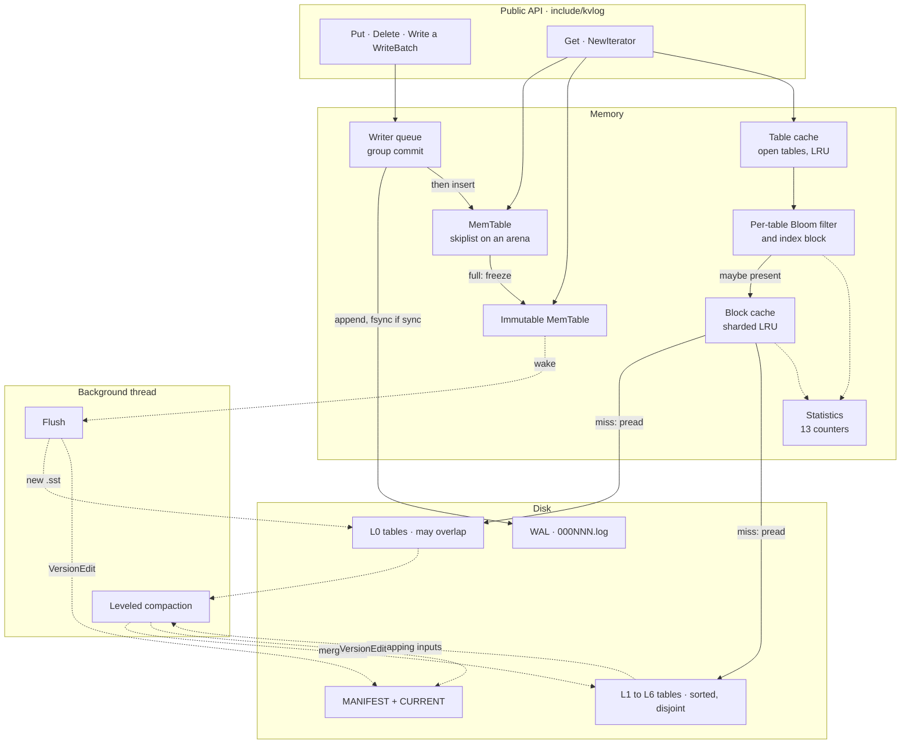
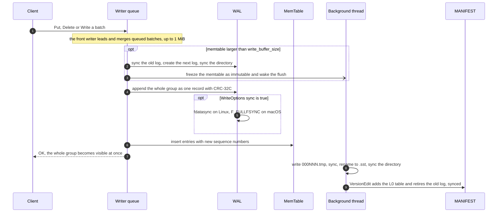
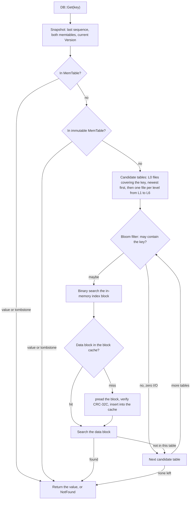
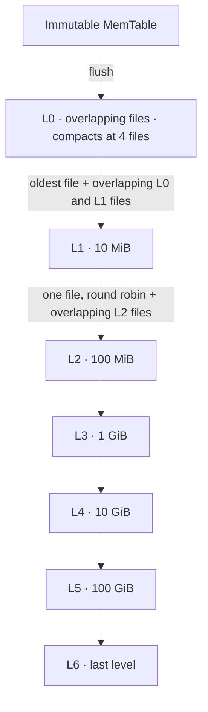

<div align="center">

# Kvlog

**A persistent key-value store on a log-structured merge tree, written from scratch in C++20.**

Write-ahead log · skiplist memtable · sorted table files · leveled compaction · Bloom filters · LRU block cache

<br/>

[](CMakeLists.txt)
[](CMakePresets.json)
[](src/util/env_posix.cc)
[](tests)
[](CMakePresets.json)

[Highlights](#highlights) · [Architecture](#architecture) · [Durability](#durability-and-crash-safety) · [Benchmarks](#benchmarks) · [Getting started](#getting-started) · [Testing](#testing) · [Design doc](docs/DESIGN.md)

</div>

---

## Overview

Kvlog is an embedded, ordered key-value store in the style of LevelDB. Writes are appended to a checksummed
write-ahead log and inserted into an in-memory skiplist. Full memtables are flushed to immutable sorted table
files, and a background thread merges those files level by level, so disk use follows the live data instead of
the write history. Point lookups skip most files through per-table Bloom filters and an LRU block cache.

The engine, CLI and benchmark are about 10k lines of C++, with another 9.4k lines of tests. Nothing outside the
C++ standard library, POSIX and threads is needed at runtime; GoogleTest is fetched for the tests only.

> [!NOTE]
> Kvlog is a single-process, embedded library built to learn and demonstrate storage-engine internals.
> It is not hardened for production use, and its on-disk format carries no compatibility promise.

<table>
<tr>
<td align="center" width="25%"><b>~1.2–1.7×</b><br/>disk use vs. live data under heavy overwrites and deletes<br/><sub>varies run to run · 22.2× with compaction off</sub></td>
<td align="center" width="25%"><b>&lt; 0.9 %</b><br/>of missing-key table probes read a data block<br/><sub>Bloom filter at 10 bits/key</sub></td>
<td align="center" width="25%"><b>190</b><br/>SIGKILLs per stress run, every acknowledged write recovered<br/><sub>plus 500+ simulated power cuts</sub></td>
<td align="center" width="25%"><b>5.5×</b><br/>dataset vs. a 512 MiB memory limit in the growth benchmark<br/><sub>disk at 1.03–1.07× the data at that size</sub></td>
</tr>
</table>

## Highlights

Each capability links to the code that implements it and to the test or measurement that backs it.

| Capability | How it is built | Evidence |
|---|---|---|
| **Buffered writes, sorted files, crash-safe log** | Writers queue up and a leader group-commits their batches as **one** WAL record (13-byte header, CRC-32C over header and payload), then inserts them into a skiplist memtable backed by an arena. A full memtable is frozen and a background thread flushes it to a sorted table file.<br/><sub>[`db_impl.cc`](src/db/db_impl.cc) · [`log_writer.cc`](src/db/log_writer.cc) · [`memtable.cc`](src/db/memtable.cc) · [`skiplist.h`](src/db/skiplist.h) · [`builder.cc`](src/db/builder.cc) · [`table_builder.cc`](src/table/table_builder.cc)</sub> | `LogTest` (17 cases, torn tails vs. real corruption), `RecoveryTest` (24), `DBTest` (19), `MemTableTest`, `SkipListTest`<br/><sub>[`log_test.cc`](tests/log_test.cc) · [`recovery_test.cc`](tests/recovery_test.cc) · [`db_test.cc`](tests/db_test.cc)</sub> |
| **Background compaction that bounds disk use** | Leveled compaction over 7 levels. L0 is scored by file count and L1–L5 by bytes, with a 10× fan-out. A merge keeps the newest version of each key and drops a tombstone once no deeper level can hold that key. A file with nothing to merge is moved by a MANIFEST edit alone.<br/><sub>[`version_set.cc`](src/db/version_set.cc) · [`compaction.cc`](src/db/compaction.cc) · [`version_edit.cc`](src/db/version_edit.cc)</sub> | 60k puts and deletes that write 19.9× the live data: disk stays at about **1.2–1.7×** live with compaction (varies with background timing; the test asserts ≤ 3×) and grows to **5.56–22.20×** without it. **1.06×** after a full `CompactRange`.<br/><sub>[`space_amp_test.cc`](tests/space_amp_test.cc) · `CompactionTest` (15) · `VersionSetTest` (22)</sub> |
| **Per-file Bloom filters** | One filter per table over user keys: XXH64 with double hashing, k = 7 at 10 bits/key. A rejected probe costs no index search and no I/O.<br/><sub>[`bloom.cc`](src/util/bloom.cc) · [`hash.cc`](src/util/hash.cc) · [`filter_block.cc`](src/table/filter_block.cc) · [`table.cc`](src/table/table.cc)</sub> | False-positive rate **0.79–0.88 %** over 100k absent keys in six key shapes, no false negatives. Missing-key lookups over 5 overlapping tables read a data block on **0.86 %** of 50,000 probes.<br/><sub>[`bloom_test.cc`](tests/bloom_test.cc) · `TableFilterDBTest` in [`table_test.cc`](tests/table_test.cc)</sub> |
| **Recovery verified by killing the process** | A helper process writes, logs every *acknowledged* op, and is `SIGKILL`ed mid-write, mid-flush or inside a compaction. The test reopens the database and verifies every key against that log. A simulated file system keeps only synced bytes and synced directory entries to model power loss.<br/><sub>[`crash_helper.cc`](tests/crash_helper.cc) · [`power_loss_env.h`](tests/power_loss_env.h) · [`fault_env.h`](tests/fault_env.h)</sub> | **190 kills per stress run** and no acknowledged op lost (about 185k ops checked per run). Power-loss sweeps crash at every one of 200+ and 300+ durability operations. 11 fault-injection cases.<br/><sub>[`stress_test.cc`](tests/stress_test.cc) · [`crash_test.cc`](tests/crash_test.cc) · [`power_loss_test.cc`](tests/power_loss_test.cc) · [`fault_injection_test.cc`](tests/fault_injection_test.cc)</sub> |
| **LRU block cache** | Sharded LRU (up to 16 shards) with a byte capacity and ref-counted handles, so a block in use survives eviction. Keyed by file number and block offset; file numbers are never reused, so entries never go stale.<br/><sub>[`cache.cc`](src/util/cache.cc) · [`table_cache.cc`](src/db/table_cache.cc)</sub> | Repeated reads of 2,000 keys add exactly 2,000 cache hits per pass and **no** block reads after the first pass.<br/><sub>`BlockCacheDBTest`, `CacheTest` (12) in [`cache_test.cc`](tests/cache_test.cc)</sub> |
| **Mixed workloads past available memory** | `kvlog_bench` grows the dataset in 256 MiB steps and runs mixed reads and overwrites after each step. A script runs it in a container capped at 512 MiB, page cache included.<br/><sub>[`kvlog_bench.cc`](bench/kvlog_bench.cc) · [`run_memlimit_bench.sh`](scripts/run_memlimit_bench.sh)</sub> | 238k–521k ops/s while the data fits in memory. At 5.5× the limit: 21k–27k ops/s with zipfian keys and 8.3k–9.7k ops/s with uniform keys. [Results](#benchmarks)<br/><sub>[`docs/BENCHMARKS.md`](docs/BENCHMARKS.md#results)</sub> |

## Architecture



- **One DB mutex, one background thread.** The mutex guards the memtable pointers, the current `Version` and the
  writer queue. The background thread runs flushes first, then manual, then automatic compactions. A long
  compaction checks between entries for a waiting memtable and flushes it on the spot.
- **Readers never hold the lock while searching.** A read copies the last sequence number and `shared_ptr`s to
  both memtables and the current `Version`, then searches without the mutex. The skiplist has a single writer and
  lock-free readers (release-store publish, acquire-load traversal).
- **Versions are immutable.** Each flush or compaction commits one `VersionEdit` to the MANIFEST, and only then
  installs a new `Version`. A table file is deleted only when no live `Version`, including one pinned by an open
  iterator, still lists it.
- **Iterators** merge the memtables and every table with a heap-based `MergingIterator`, then `DBIter` hides
  older versions and tombstones. They bypass the block cache on purpose so a scan cannot evict the hot set.

Full detail: [`docs/DESIGN.md`](docs/DESIGN.md).

### Write path



A write is acknowledged only after its WAL record is appended (and synced when `sync = true`). Any failed append,
sync or MANIFEST update sets a **sticky error**: all later writes fail until the database is reopened, so nothing
is ever appended after a possibly torn record.

### Read path



Each table costs at most one Bloom probe, one in-memory index search and one data-block read
([`Table::InternalGet`](src/table/table.cc), [`Version::Get`](src/db/version_set.cc)).

### Compaction and levels



- **Scoring.** L0 is scored as `files / level0_compaction_trigger`; L1–L5 as `bytes / (10 MiB × 10^(level−1))`.
  The background thread compacts the highest-scoring level while any score is ≥ 1.
- **Merging.** A merging iterator keeps the newest entry for each user key. A tombstone is dropped only when no
  deeper level can still hold that key ([`Compaction::IsBaseLevelForKey`](src/db/compaction.cc)).
- **Outputs** go through the normal table builder, so they carry Bloom filters too. They are cut at
  `target_file_size` (2 MiB), or earlier if they would overlap more than 10× that in the next level, and only
  between user keys, so levels ≥ 1 never overlap. `LogAndApply` rejects any edit that would break this.
- **Trivial moves.** A single input with nothing to merge below is moved by a MANIFEST edit alone.
- **Back-pressure.** At 8 L0 files each write group sleeps about 1 ms; at 12 writers block until compaction
  catches up. `DB::CompactRange` compacts any key range on demand.

### Space amplification (measured)

[`SpaceAmpTest`](tests/space_amp_test.cc) runs 60,000 operations over 3,000 keys (three quarters puts of 100-byte
values, one quarter deletes), writing 19.9× the final live data (245,795 B). Disk use is every `.sst` and `.log`
byte, measured at each quarter of the run. One run of the `debug` preset:

| Progress | 25 % | 50 % | 75 % | 100 % |
|---|---:|---:|---:|---:|
| **With compaction** (varies run to run) | 1.31× | 1.42× | 1.54× | 1.65× |
| Compaction disabled | 5.56× | 11.12× | 16.67× | 22.20× |

The compaction-off row and the final `CompactRange` result (**1.06×** of the live data) are deterministic. The
with-compaction row depends on how background compactions interleave with the writes: repeated runs on the
`release` preset ranged from about **1.2× to 1.7×** at the checkpoints. The test asserts ≤ 3× at every checkpoint
with compaction on, and strictly growing past 10× with it off.

## Durability and crash safety

| Failure | `WriteOptions::sync = false` (default) | `WriteOptions::sync = true` |
|---|---|---|
| Process crash (`SIGKILL`, abort) | every acknowledged write survives | every acknowledged write survives |
| Power loss or kernel crash | the last few writes may be lost | every acknowledged write survives |

**How data reaches the disk** ([`env_posix.cc`](src/util/env_posix.cc), [`db_impl.cc`](src/db/db_impl.cc))

- **Device-level syncs.** `fdatasync` for files and `fsync` for directories on Linux; `fcntl(F_FULLFSYNC)` on
  macOS, which also flushes the drive's volatile cache.
- **Atomic installs.** Tables are written as `000NNN.tmp`, synced, renamed to `.sst`, the directory is synced,
  and the table is reopened to verify its footer and index before any MANIFEST edit names it. `CURRENT` is
  replaced the same way.
- **Ordering.** The retiring log is synced before the next log takes writes. A MANIFEST edit is synced before the
  new version is installed and before any obsolete file is deleted. A log is deleted only after a durable edit
  says its contents live in tables.
- **One owner.** `LOCK` is held with `flock`, so a second `DB::Open` from any process gets `Busy`.

**Recovery** ([`DB::Open`](src/db/db_impl.cc), [`log_reader.cc`](src/db/log_reader.cc))

1. Take `LOCK`, read `CURRENT`, replay the MANIFEST. A torn final edit was never committed and is ignored; any
   other damage fails the open.
2. Replay every log at or after the MANIFEST's log number, oldest first, into L0 tables. A **torn tail** (the
   file ends inside a record, or a checksum fails over trailing zero fill) is dropped.
3. Real **corruption** either fails the open (`paranoid_checks = true`) or triggers point-in-time recovery: keep
   everything before the damage, copy the affected logs to `lost/` with a `RECOVERY-<seq>.txt` note, and report
   it in `kvlog.stats`.
4. Start a new log and commit everything in one synced MANIFEST edit, then delete obsolete files.

**How it is tested.** Every kill below is a real `SIGKILL` of a child process
([`crash_helper.cc`](tests/crash_helper.cc)), which records each op only after the database acknowledges it.
After every kill the test reopens the database (the two crash loops and `CrashTest` with `paranoid_checks`) and
checks each key against that record: the last acknowledged value or the one op in flight, nothing invented,
scans sorted. Ranges cover five build configurations: macOS debug, ASan and TSan, and Linux with g++ 13.3 and
with clang 18 ASan + UBSan.

| Test | What it does | Result per run |
|---|---|---|
| [`StressTest.CrashLoop…`](tests/stress_test.cc) | 40 kills at random points during writes | 42,754–43,296 acknowledged ops verified |
| [`StressTest.CompactionCrashLoop…`](tests/stress_test.cc) | 120 kills on one database with tiny buffers, so flushes and compactions run constantly | 141,955–142,552 ops verified; 939–1,000 flushes and 451–544 compactions in the killed processes; 96–108 kills landed mid table write |
| [`StressTest.KillsInsideManualCompactions…`](tests/stress_test.cc) | Stalls the n-th append to a compaction output, then kills | 30 of 30 kills inside the compaction; inputs intact, no partial output |
| [`CrashTest`](tests/crash_test.cc), [`RecoveryTest.Killed…`](tests/recovery_test.cc) | Kills during synced and unsynced writes, constant compaction and a manual compaction | runs in the default suite |
| [`PowerLossTest`](tests/power_loss_test.cc) | Crashes at **every** sync, directory sync, rename, create and unlink of a 150-op workload, then drops all unsynced data | 200+ and 300+ crash points, all recover |
| [`FaultInjectionTest`](tests/fault_injection_test.cc) | Fails appends, syncs, creates, renames and MANIFEST or `CURRENT` updates | 11 cases: writes stop cleanly, no partial tables |

Removing the table sync, or the retiring-log sync, makes both power-loss tests fail, so they test the sync
order rather than passing by luck.

## Bloom filters and block cache

**Filter.** One Bloom filter per table over its user keys, stored in a filter block named `filter.kvlog.bloom64`.
Keys are hashed once with an in-tree XXH64 (checked against published test vectors), and probe *j* tests bit
`(h1 + j·h2) mod m` using the two 32-bit halves. With the default 10 bits per key, k = round(10 · ln 2) = 7. A
malformed filter matches every key, so it can cost a read but never hide a key.

**Cache.** A sharded LRU with a byte capacity (`block_cache_capacity`, default 8 MiB; 0 disables it), up to 16
shards (fewer for small caches). Point lookups use and fill it. Iterators and compaction inputs bypass it so a
scan cannot evict the working set.

| Measurement | Result | Test |
|---|---|---|
| Bloom false-positive rate, 100k keys, 100k absent probes, six key shapes | **0.79–0.88 %**, no false negatives | [`BloomTest`](tests/bloom_test.cc) |
| Missing-key `Get`s over 5 overlapping L0 tables | 432 data-block reads in 50,000 table probes (**0.86 %**) | [`TableFilterDBTest`](tests/table_test.cc) |
| Missing-key `Get`s after a full compaction | 1,978 filter checks, 1,963 rejected, 15 block reads (**0.76 %**) | [`CompactionTest`](tests/compaction_test.cc) |
| Two passes of 500 present-key `Get`s | 44 block reads, all in the first pass; **956 cache hits** | [`CompactionTest`](tests/compaction_test.cc) |
| Four passes over 2,000 keys, 1 KiB blocks | block reads flat after pass 1; exactly +2,000 hits on each later pass | [`BlockCacheDBTest`](tests/cache_test.cc) |
| Lookups with the cache disabled | 1,000 lookups → 1,000 block reads | [`BlockCacheDBTest`](tests/cache_test.cc) |

All of these counters are available at runtime through `Options::statistics` (13 counters) and the `kvlog.stats`
property.

## Benchmarks

**Question:** how does mixed read/write throughput hold up as the dataset grows past the memory available?
`kvlog_bench` in growth mode adds 256 MiB of new keys per step, then runs 200,000 mixed operations over all keys
loaded so far. [`run_memlimit_bench.sh`](scripts/run_memlimit_bench.sh) runs it in a Linux container whose cgroup
limit (512 MiB) also counts the page cache, so past the limit, reads that miss memory really leave the container.

```text
Workload  growth mode, single thread, 16-byte keys, 1000-byte values
          11 steps of 256 MiB, up to 2816 MiB of data (5.5x the limit), 200,000 mixed ops per step
          Bloom 10 bits/key, 4 MiB write buffer, sync off, zipfian theta 0.99
Limit     docker run --memory 512m --memory-swap 512m --cpus 2
Build     Release (-O3 -DNDEBUG), g++ 13.3.0, Ubuntu 24.04 image
Host      Apple M5 MacBook Air, 10 cores, 16 GB RAM, Docker Desktop Linux VM (cgroup v2)
```

Throughput of the mixed operations (ops/s) at each dataset size, relative to the 512 MiB limit:

| Keys · reads · block cache | 0.5× | 1× | 2× | 5.5× | 5.5× vs. 0.5× | p50 / p99 at 5.5× |
|---|---:|---:|---:|---:|---:|---:|
| zipfian · 90 % · 8 MiB | 452,959 | 117,533 | 42,730 | 21,513 | 4.7 % | 4.8 / 194 µs |
| zipfian · 90 % · 128 MiB | 521,182 | 85,511 | 36,814 | 20,960 | 4.0 % | 3.2 / 203 µs |
| zipfian · 50 % · 8 MiB | 284,408 | 95,054 | 47,856 | 27,032 | 9.5 % | 2.0 / 387 µs |
| zipfian · 50 % · 128 MiB | 282,600 | 59,686 | 42,704 | 24,165 | 8.6 % | 2.2 / 704 µs |
| uniform · 90 % · 8 MiB | 237,932 | 64,308 | 14,865 | 9,660 | 4.1 % | 117 / 289 µs |
| uniform · 90 % · 128 MiB | 271,551 | 52,835 | 19,927 | 8,344 | 3.1 % | 128 / 350 µs |

**What it shows**

- **The cliff is at the limit.** At 1× the data on disk (535–575 MiB) no longer fits, and throughput falls to
  16–33 % of the in-memory rate while p99 rises from 7–14 µs to 132–184 µs.
- **After that, decline is gradual.** From 2× to 5.5× the limit the runs kept 42–65 % of their throughput.
  Zipfian workloads keep a 2–5 µs median because hot keys stay cached; uniform keys with 90 % reads are the
  worst case (median 117–128 µs).
- **Writes stay cheap.** The 50 % read runs held more throughput at 5.5× than the 90 % runs, since a put only
  appends to the log and the memtable. No run hit a write stop.
- **Filters and compaction kept working.** The Bloom filter answered 58.9–78.4 % of table probes without a read,
  and at 5.5× the limit disk use was 1.03–1.07× the logical data, after 1,533–1,984 compactions (1.02–1.32×
  across all steps).
- **A bigger cache raised hit rates, not throughput, past the limit.** The likely reason, not measured
  separately: the block cache is charged to the same 512 MiB and duplicates blocks already in the page cache.

**Caveats.** Each configuration ran once, on a laptop with light background load. Docker Desktop's VM disk is a
file on the host, so some "disk" reads may have come from the host's file cache; the penalty measured is a
virtual-disk read and may be smaller than a real device read. Full environment, commands, per-step tables and
CSVs: [`docs/BENCHMARKS.md`](docs/BENCHMARKS.md#results).

<details>
<summary><b>Per-step results for one run</b> (zipfian keys, 90 % reads, 8 MiB block cache)</summary>

<br/>

| Step | Data (MiB) | On disk (MiB) | ops/s | p50 (µs) | p99 (µs) | Cache hits | Filter skips | Compactions |
|---:|---:|---:|---:|---:|---:|---:|---:|---:|
| 1 | 256 | 270.4 | 452,959 | 1.25 | 6.96 | 19.6 % | 60.5 % | 127 |
| 2 | 512 | 534.6 | 117,533 | 1.79 | 140.67 | 17.2 % | 64.2 % | 240 |
| 3 | 768 | 797.3 | 60,397 | 2.21 | 144.42 | 15.9 % | 68.3 % | 348 |
| 4 | 1024 | 1056.1 | 42,730 | 2.58 | 151.12 | 15.1 % | 63.3 % | 484 |
| 5 | 1280 | 1310.5 | 34,094 | 3.04 | 159.12 | 14.3 % | 58.9 % | 690 |
| 6 | 1536 | 1582.9 | 29,480 | 3.67 | 174.50 | 14.0 % | 68.0 % | 810 |
| 7 | 1792 | 1845.4 | 26,004 | 4.21 | 196.67 | 13.5 % | 69.9 % | 958 |
| 8 | 2048 | 2114.6 | 23,823 | 4.33 | 257.62 | 13.3 % | 64.8 % | 1086 |
| 9 | 2304 | 2371.4 | 23,314 | 4.58 | 206.38 | 12.8 % | 66.4 % | 1303 |
| 10 | 2560 | 2640.9 | 23,396 | 4.46 | 177.08 | 13.1 % | 67.3 % | 1422 |
| 11 | 2816 | 2912.1 | 21,513 | 4.83 | 193.96 | 13.0 % | 71.7 % | 1537 |

</details>

## Getting started

**Prerequisites:** CMake ≥ 3.20, Ninja and a C++20 compiler on Linux or macOS. Tested with Apple clang 21
(macOS arm64), and with g++ 13.3 and clang 18.1 on Ubuntu 24.04. The first configure downloads GoogleTest 1.17.0.

```bash
git clone https://github.com/Jenil133/Kvlog.git
cd Kvlog

cmake --preset release
cmake --build --preset release
ctest --preset release            # 265 tests; the long stress tests are excluded
```

| Preset | Build | Use it for |
|---|---|---|
| `debug` | Debug | development |
| `release` | Release | the CLI and benchmarks |
| `asan` | Debug + AddressSanitizer + UndefinedBehaviorSanitizer | memory errors, undefined behavior |
| `tsan` | Debug + ThreadSanitizer | races between writers, readers, flush and compaction |

Every preset has a matching test preset, plus a `-stress` variant that runs only the long crash and randomized
tests:

```bash
cmake --preset asan && cmake --build --preset asan
ctest --preset asan                          # default suite under ASan + UBSan
ctest --preset asan-stress                   # 190 SIGKILLs, model check, concurrency stress
ctest --preset debug -R 'PowerLoss|SpaceAmp' # any subset by test name
```

Builds use `-Wall -Wextra -Wpedantic` on Kvlog's own targets. The CMake options `KVLOG_BUILD_TESTS`,
`KVLOG_BUILD_TOOLS` and `KVLOG_BUILD_BENCH` (all `ON`) and `KVLOG_SANITIZER` (`address` or `thread`) control the rest.

## Usage

### As a library

The public API is the headers in [`include/kvlog/`](include/kvlog); everything under `src/` is internal.

```cpp
#include <iostream>
#include <memory>
#include <string>

#include "kvlog/db.h"

int main() {
  kvlog::Options options;
  options.create_if_missing = true;
  options.statistics = std::make_shared<kvlog::Statistics>();

  std::unique_ptr<kvlog::DB> db;
  kvlog::Status s = kvlog::DB::Open(options, "/tmp/kvlog-demo", &db);
  if (!s.ok()) {
    std::cerr << s.ToString() << "\n";
    return 1;
  }

  kvlog::WriteOptions sync_write;
  sync_write.sync = true;  // survives power loss, not just a process crash
  s = db->Put(sync_write, "apple", "red");
  if (!s.ok()) return 1;

  kvlog::WriteBatch batch;  // applied atomically
  batch.Put("banana", "yellow");
  batch.Delete("apple");
  s = db->Write(kvlog::WriteOptions(), batch);
  if (!s.ok()) return 1;

  std::string value;
  s = db->Get(kvlog::ReadOptions(), "banana", &value);
  if (s.ok()) std::cout << "banana = " << value << "\n";
  if (db->Get(kvlog::ReadOptions(), "apple", &value).IsNotFound()) {
    std::cout << "apple deleted\n";
  }

  std::unique_ptr<kvlog::Iterator> it = db->NewIterator(kvlog::ReadOptions());
  for (it->SeekToFirst(); it->Valid(); it->Next()) {
    std::cout << it->key() << " -> " << it->value() << "\n";
  }
  if (!it->status().ok()) return 1;
  it.reset();  // iterators must be destroyed before the DB

  std::string stats;
  if (db->GetProperty("kvlog.stats", &stats)) std::cout << stats;
  return 0;
}
```

```text
banana = yellow
apple deleted
banana -> yellow
Level  Files  Bytes         Compactions  Moves      Read(B)   Written(B)
    0      0  0                       0      0            0            0
...
```

There are no install rules yet. From another CMake project, add the source tree and link the `kvlog` target:

```cmake
set(KVLOG_BUILD_TESTS OFF CACHE BOOL "" FORCE)
set(KVLOG_BUILD_TOOLS OFF CACHE BOOL "" FORCE)
set(KVLOG_BUILD_BENCH OFF CACHE BOOL "" FORCE)
add_subdirectory(path/to/Kvlog kvlog)
target_link_libraries(my_app PRIVATE kvlog)
```

<details>
<summary><b>API at a glance</b></summary>

<br/>

| Call | Notes |
|---|---|
| `DB::Open(options, path, &db)` | `create_if_missing`, `error_if_exists`; a second open of the same path returns `Busy` |
| `Put` · `Delete` · `Write(WriteBatch)` | `WriteOptions::sync` chooses crash vs. power-loss durability; a batch is atomic |
| `Get(ReadOptions, key, &value)` | `NotFound` if absent; every read sees a consistent snapshot |
| `NewIterator(ReadOptions)` | snapshot iterator: `SeekToFirst`, `Seek`, `Next` (forward only) |
| `Flush()` · `CompactRange(begin, end)` · `WaitForBackgroundWork()` | manual control of background work |
| `GetProperty(name, &out)` | `kvlog.stats`, `kvlog.sstables`, `kvlog.num-files-at-level<N>`, `kvlog.approximate-memory-usage` |
| `DestroyDB(path, options)` | deletes a closed database |

Keys and values are arbitrary byte strings, ordered by unsigned bytewise comparison. `Status` is `[[nodiscard]]`.
All 20 options, their defaults and their allowed ranges are in [`options.h`](include/kvlog/options.h) and
[`docs/DESIGN.md`](docs/DESIGN.md#public-api-and-options).

</details>

### Command-line tool

`kvlog_cli` opens a database, runs one command and exits. A real session:

```console
$ ./build/release/kvlog_cli /tmp/demo put user:1 alice
$ ./build/release/kvlog_cli --sync /tmp/demo put user:2 bob
$ ./build/release/kvlog_cli /tmp/demo put user:3 carol
$ ./build/release/kvlog_cli /tmp/demo get user:1
alice
$ ./build/release/kvlog_cli /tmp/demo delete user:1
$ ./build/release/kvlog_cli /tmp/demo get user:1
kvlog_cli: key not found
$ echo $?
1
$ ./build/release/kvlog_cli /tmp/demo scan
user:2	bob
user:3	carol
$ ./build/release/kvlog_cli --limit=1 /tmp/demo scan user: user:9
user:2	bob
$ ./build/release/kvlog_cli /tmp/demo flush
$ ./build/release/kvlog_cli /tmp/demo stats
Level  Files  Bytes         Compactions  Moves      Read(B)   Written(B)
    0      2  340                     0      0            0            0
    1      0  0                       0      0            0            0
    2      0  0                       0      0            0            0
    3      0  0                       0      0            0            0
    4      0  0                       0      0            0            0
    5      0  0                       0      0            0            0
    6      0  0                       0      0            0            0
flushes: 0  flushed bytes: 0  write stalls: 0  slowdowns: 0  stops: 0
last sequence: 4  log: 24  manifest: 25  batches recovered: 0
block cache: capacity 8388608  usage 0  hits 0  misses 0  evictions 0
```

Commands: `put`, `get`, `delete`, `scan [start [end]]`, `flush`, `stats`. Exit codes: 0 ok, 1 not found, 2 usage,
3 error. Each run reopens the database, so a non-empty log from the previous run is replayed into an L0 table.

### Benchmark tool

```bash
# Classic workloads on one database (single thread)
./build/release/bench/kvlog_bench --benchmarks=fillrandom,readrandom,readmissing,mixed90 \
    --num=1000000 --key_dist=zipfian --verify=1 --stats=1

# Growth past a 512 MiB container limit (needs Docker)
docker build -t kvlog-dev docker/                       # Ubuntu 24.04 with g++, Clang, CMake, Ninja
SMOKE=1 scripts/run_memlimit_bench.sh                   # seconds, checks the pipeline
MAX_BYTES=2684354560 READ_PCT=90 KEY_DIST=zipfian scripts/run_memlimit_bench.sh
python3 scripts/csv_to_markdown.py bench/results/growth-*.csv           # CSV to Markdown tables
```

`kvlog_bench --help` lists every flag. Each summary line reports ops/s, p50/p99 latency, block-cache hit rate,
Bloom filter skip rate, bytes on disk and compactions.

## Testing

**265 tests** in the default suite and **5** long stress tests, all written with GoogleTest. They pass with zero
compiler warnings and zero sanitizer reports on macOS (debug, ASan + UBSan, TSan) and on Linux (g++ 13.3 debug,
clang 18.1 ASan + UBSan).

| Area | Suites | Tests |
|---|---|---:|
| Recovery and durability | `RecoveryTest`, `FaultInjectionTest`, `PowerLossTest`, `PowerLossEnvTest`, `CrashTest`, `DBOpenTest` | 46 |
| Versions, MANIFEST, compaction | `VersionSetTest`, `VersionEditTest`, `CompactionTest`, `SpaceAmpTest` | 43 |
| Tables, blocks, iterators | `TableTest`, `TableFormatTest`, `BlockTest`, `BlockBuilderTest`, restart intervals, `TwoLevelIteratorTest`, `MergingIteratorTest`, `DBIterTest` | 39 |
| Memtable and utilities | `MemTableTest`, `SkipListTest`, `ArenaTest`, `CodingTest`, `Crc32cTest`, `FormatTest`, `FileNameTest` | 37 |
| Bloom filter, hash, cache | `BloomTest`, `FilterBlockTest`, `TableFilterDBTest`, `HashTest`, `CacheTest`, `CacheShardingTest`, `BlockCacheDBTest` | 35 |
| Write-ahead log | `LogTest`, `LogWriterTest`, `WriteBatchTest` | 25 |
| DB API and concurrency | `DBTest`, `ConcurrencyTest` | 23 |
| CLI and benchmark | `CliTest`, `WorkloadTest`, three `kvlog_bench` smoke runs | 17 |
| **Stress** (label `stress`) | random ops checked against a model, two crash-kill loops, kills inside manual compactions, concurrent writers, readers and flushes | 5 |

<details>
<summary><b>On-disk format</b></summary>

<br/>

**Files in a database directory** ([`filename.cc`](src/db/filename.cc)). All numbers come from one counter and
are never reused.

```text
CURRENT              name of the live MANIFEST; replaced via temp file, sync, rename, directory sync
LOCK                 flock()ed while the database is open
MANIFEST-000NNN      log-format file of VersionEdit records; a new one starts with a full snapshot
000NNN.log           write-ahead log
000NNN.sst           sorted table
000NNN.tmp           table being built; never named by the MANIFEST
lost/                logs that point-in-time recovery could not fully replay, plus RECOVERY-<seq>.txt
```

**WAL and MANIFEST record** ([`log_format.h`](src/db/log_format.h)). One record per write group or per
`VersionEdit`, with no 32 KiB block fragmentation:

```text
+-------------+-------------+-------------+--------+---------------------+
| header_crc  | payload_crc |   length    |  type  |       payload       |
|  fixed32    |  fixed32    |  fixed32    |  u8    |   length bytes      |
+-------------+-------------+-------------+--------+---------------------+
  CRC-32C of    CRC-32C of                 1 = full
  bytes 4..12   the payload                0 = reserved, never written
```

The header has its own checksum, so a damaged length is caught rather than read past the end of the file. A WAL
payload is a `WriteBatch`: `sequence (fixed64) | count (fixed32) | records`, where each record is
`0x01 key value` or `0x00 key`. A MANIFEST payload is a tagged `VersionEdit` that always ends with the tag
`0x7f`. CRCs are stored masked, as in LevelDB.

**Internal key.** `user_key | fixed64 (sequence << 8 | type)`, type 1 = value and 0 = deletion, 56-bit sequence
numbers. Sorted by user key ascending, then sequence descending.

**Table file** ([`format.h`](src/table/format.h), [`table_builder.cc`](src/table/table_builder.cc)):

```text
+------------------+
| data block 1     |  prefix-compressed entries, full key every 16 (restart points)
| ...              |  cut at block_size (4 KiB by default)
| data block N     |
+------------------+
| filter block     |  one Bloom filter over every user key in the table
| metaindex block  |  "filter.kvlog.bloom64" -> filter block handle
| index block      |  last key of each data block -> (offset, size); kept in memory
+------------------+
| footer, 52 bytes |  metaindex handle | index handle | padding | version | magic "KVLOGTB1"
+------------------+
every block is followed by a 5-byte trailer: type byte (0 = raw) | masked CRC-32C
```

`Table::Open` verifies the footer, index, metaindex and filter, and every block handle is bounds-checked against
the file size. Full details: [`docs/DESIGN.md`](docs/DESIGN.md#files-and-formats).

</details>

## Project layout

```text
include/kvlog/      public API: db.h, options.h, write_batch.h, iterator.h, status.h, statistics.h, env.h
src/db/             DBImpl (open, recovery, group commit, flush, compaction), WAL reader and writer,
                    memtable and skiplist, Version / VersionSet / MANIFEST, table cache, file names
src/table/          table builder and reader, blocks, filter block, footer format,
                    merging and two-level iterators
src/util/           arena, Bloom filter, sharded LRU cache, varint coding, CRC-32C, XXH64, POSIX Env
tools/              kvlog_cli
bench/              kvlog_bench and its key and value generators
scripts/            run_memlimit_bench.sh (container memory-limit runs), csv_to_markdown.py
tests/              GoogleTest suites, crash helper process, fault-injection and power-loss Envs
docs/               DESIGN.md (internals), BENCHMARKS.md (method and full results)
docker/             Dockerfile for the Linux build and benchmark image
```

## Design notes and limitations

- **Leveled, not tiered, compaction.** It keeps space amplification low (about 1.2–1.7× live under churn in `SpaceAmpTest`) and
  bounds a lookup to one file per level below L0, at the cost of more write amplification.
- **One Bloom filter per table** instead of one per 2 KiB of data, so a negative answer needs no index search.
  The trade-off is that the whole filter stays in memory while the table is open.
- **No log fragmentation.** A WAL record holds a whole write group; the reader tells a torn tail from real
  corruption using the header checksum and the shape of trailing zero fill.
- **`sync = false` by default**, like LevelDB: a write survives a process crash, and `sync = true` adds power-loss
  safety at the cost of a device flush per write group.

<details>
<summary><b>Known limitations and non-goals</b></summary>

<br/>

- Single process, embedded: no server, no replication, no transactions or explicit snapshot API.
- Iterators are forward only (`SeekToFirst`, `Seek`, `Next`).
- No block compression; the trailer's type byte only ever says "raw".
- Bytewise key order only; no custom comparators.
- One background thread, so flushes and compactions run one at a time; `kvlog_bench` is single-threaded.
- Compaction round-robin pointers are not persisted and restart after a reopen.
- Index keys are full last keys, without LevelDB's shortest-separator trick.
- A damaged final WAL record whose payload ends in a run of zero bytes that is 32+ bytes long or starts on a
  512-byte boundary is indistinguishable from zero fill, so it is dropped as a torn tail even with
  `paranoid_checks` (the sector-boundary case is pinned by a test). The MANIFEST is not affected.
- The power-loss model covers files directly in the database directory.
- No install rules or package, and no on-disk compatibility promise.

</details>

## References

- P. O'Neil, E. Cheng, D. Gawlick, E. O'Neil. [*The Log-Structured Merge-Tree (LSM-Tree)*](https://www.cs.umb.edu/~poneil/lsmtree.pdf). Acta Informatica 33, 1996.
- B. H. Bloom. *Space/Time Trade-offs in Hash Coding with Allowable Errors.* Communications of the ACM 13(7), 1970.
- A. Kirsch, M. Mitzenmacher. *Less Hashing, Same Performance: Building a Better Bloom Filter.* ESA 2006.
- [LevelDB implementation notes](https://github.com/google/leveldb/blob/main/doc/impl.md) and [table format](https://github.com/google/leveldb/blob/main/doc/table_format.md).
- [RocksDB wiki](https://github.com/facebook/rocksdb/wiki): leveled compaction and read, write and space amplification.
- [xxHash](https://github.com/Cyan4973/xxHash) (XXH64) and the CRC-32C (Castagnoli) polynomial.

---

<div align="center">
<sub>Built by <a href="https://github.com/Jenil133">@Jenil133</a> · C++20 · Linux and macOS</sub>
</div>
