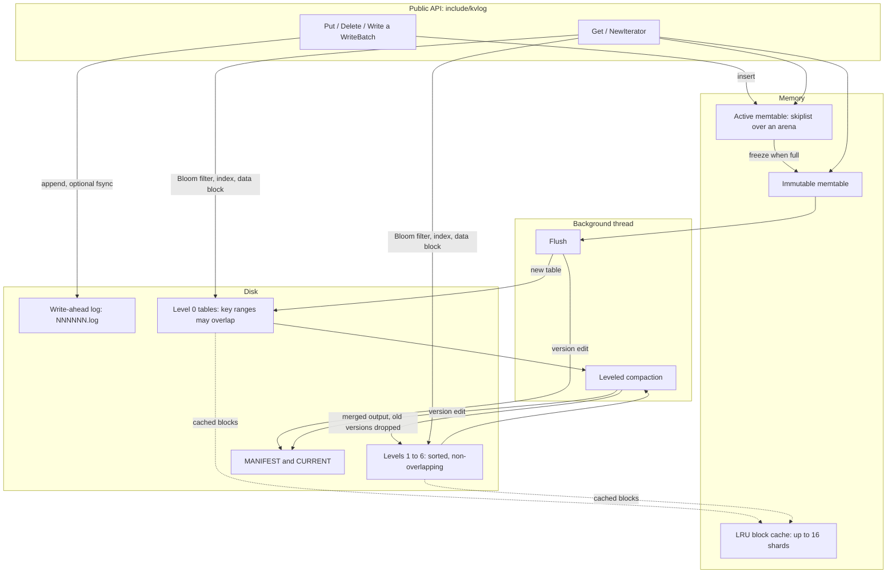
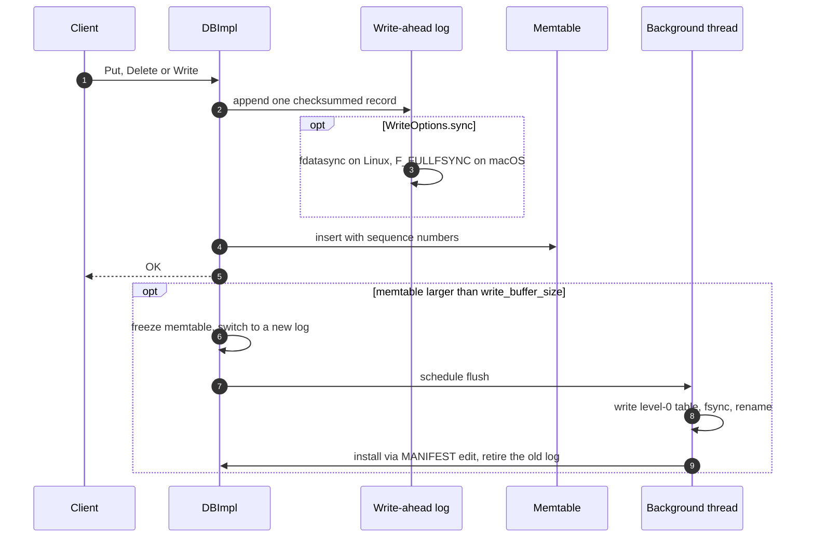
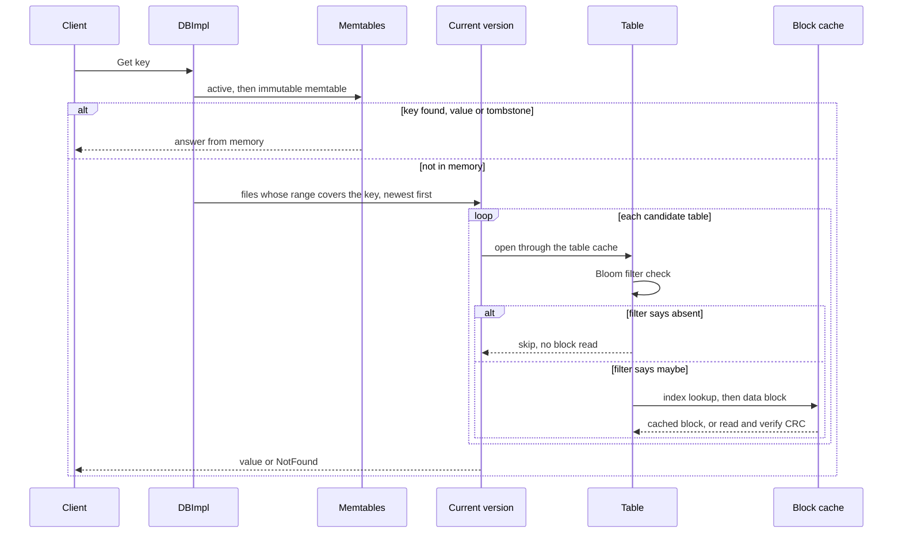

<div align="center">

# Kvlog

**A persistent key-value store built on a log-structured merge tree, written in modern C++.**

Write-ahead logging · skiplist memtable · sorted table files · leveled background compaction · per-file Bloom filters · sharded LRU block cache


</div>

---

Kvlog stores arbitrary byte-string keys and values on disk. Writes are made durable in a
write-ahead log and buffered in an in-memory table; full tables are flushed to immutable,
sorted files that a background thread merges level by level. Reads check memory first, then
consult each candidate file's Bloom filter before touching its index or data blocks, which
are served from an LRU block cache when possible. The design follows the LSM-tree family of
engines (LevelDB, RocksDB); every component here is implemented from scratch.

## Contents

- [Highlights](#highlights)
- [Architecture](#architecture)
- [Storage format](#storage-format)
- [Compaction](#compaction)
- [Bloom filters and block cache](#bloom-filters-and-block-cache)
- [Durability and crash recovery](#durability-and-crash-recovery)
- [Getting started](#getting-started)
- [Usage](#usage)
- [Benchmarks](#benchmarks)
- [Testing](#testing)
- [Project layout](#project-layout)
- [Design notes and limitations](#design-notes-and-limitations)
- [References](#references)

## Highlights

| Feature | Where | Evidence |
|---|---|---|
| Writes buffered in a skiplist memtable, flushed to sorted table files, guarded by a checksummed write-ahead log | `src/db/memtable.*`, `src/db/log_*`, `src/table/` | WAL torn-tail tests at every byte offset; recovery tests after unclean shutdown |
| Background leveled compaction that merges overlapping files and drops overwritten and deleted keys | `src/db/compaction.*`, `src/db/version_set.*`, `src/db/db_impl.cc` | Space-amplification test: disk use stays at **1.31x to 1.65x** of the live data while the workload writes **19.9x** the live data; with compaction disabled it grows to **22.2x** |
| Per-file Bloom filters checked before any index or data block | `src/util/bloom.*`, `src/table/filter_block.*` | Measured false-positive rate **0.79% to 0.88%** at 10 bits/key; only **0.86%** of missing-key lookups touched a data block |
| Recovery verified by killing the process mid-write | `tests/crash_*`, `tests/stress_test.cc`, `tests/power_loss_test.cc` | 120 `SIGKILL`s per crash run (**141,955** acknowledged writes verified across 958 flushes and 451 compactions); power-loss simulation at every sync, rename, create and unlink |
| Sharded LRU block cache with reference-counted handles | `src/util/cache.*`, `src/db/table_cache.*` | Two passes of 500 reads over the same keys: **956** cache hits, **44** block reads |
| Mixed read/write benchmark that grows the dataset past a memory limit | `bench/kvlog_bench.cc`, `scripts/run_memlimit_bench.sh` | Growth mode measures throughput, p50/p99 latency, cache hit rate and Bloom effectiveness at every step inside a cgroup memory limit |

## Architecture



### Write path



### Read path



## Storage format

<details>
<summary><b>Files in a database directory</b></summary>

```text
CURRENT            name of the live MANIFEST, replaced atomically
LOCK               flock()ed while the database is open
MANIFEST-<number>  log of version edits (the set of live table files)
<number>.log       write-ahead log
<number>.sst       table file
lost/              logs set aside by recovery, with a RECOVERY note
```
</details>

<details>
<summary><b>Write-ahead log record</b></summary>

```text
offset 0   fixed32  header_crc    masked CRC-32C of bytes [4, 13)
offset 4   fixed32  payload_crc   masked CRC-32C of the payload
offset 8   fixed32  length        payload size in bytes
offset 12  uint8    type          record type
offset 13  payload  (length bytes): one encoded WriteBatch
```

The header carries its own checksum, so a damaged length field is reported instead of being
trusted. A torn final record, the normal result of a crash mid-append, is dropped on recovery;
damage anywhere else is caught by the checksums and handled according to
`Options::paranoid_checks`.
</details>

<details>
<summary><b>Table (.sst) file</b></summary>

```text
[data block 0] ... [data block N-1]   sorted internal keys, prefix-compressed,
                                      restart points every 16 keys
[filter block]                        one Bloom filter over the table's user keys
[metaindex block]                     meta block name -> block handle
[index block]                         last key of each data block -> block handle
[footer]                              metaindex handle | index handle | padding |
                                      format version | magic 0x4b564c4f47544231
```

Every block is followed by a 5-byte trailer: a storage type byte and a masked CRC-32C of the
block contents. Tables are written to a temporary name, synced, renamed into place and the
directory is synced, so a crash never exposes a partial table.
</details>

## Compaction


- **Picking work.** Level 0 compacts when it holds `level0_compaction_trigger` files (default 4).
  Deeper levels compact when their size exceeds `max_bytes_for_level_base` (10 MiB) times
  `max_bytes_for_level_multiplier` (10) per level. Each compaction takes its inputs plus every
  overlapping file of the next level.
- **Merging.** A k-way merging iterator keeps only the newest version of every key. A tombstone
  is dropped only when no deeper level can still hold that key; otherwise it is carried down.
  Output files are cut at `target_file_size` (2 MiB) and only between user keys, so levels 1
  and deeper never overlap.
- **Installing.** Inputs and outputs are swapped in a single MANIFEST edit. Obsolete files are
  deleted only when no live version, including one pinned by an open iterator, still lists them.
- **Back-pressure.** At `level0_slowdown_writes_trigger` (8) each write is delayed by about 1 ms;
  at `level0_stop_writes_trigger` (12) writes wait for compaction. `compaction_throttle_us`
  rate-limits compaction I/O, and `DB::CompactRange` compacts a key range on demand.

## Bloom filters and block cache

**Bloom filters.** Every table stores one filter over its user keys. Keys are hashed once with
XXH64 and the two 32-bit halves drive double hashing (Kirsch and Mitzenmacher) to set
`k = round(bits_per_key x ln 2)` bits. At the default 10 bits per key, k = 7. Because the
filter is checked before the index, a negative answer costs no index search and no block read.

**Block cache.** Data blocks are cached in a sharded LRU cache with a byte capacity
(`block_cache_capacity`, 8 MiB by default). Keys hash to one of up to 16 shards, each with its
own mutex, and handles are reference-counted, so a block that is being read survives eviction.

| Measurement | Result |
|---|---|
| False-positive rate at 10 bits/key, six key shapes | 0.79% to 0.88% |
| Missing-key lookups that touched a data block (50,000 probes over 5 level-0 tables) | 432 (0.86%) |
| Two passes of 500 reads over the same keys | 956 cache hits, 44 block reads |

All counters are exposed through `Options::statistics` and the `kvlog.stats` property.

## Durability and crash recovery

- `WriteOptions::sync = true` forces the log to stable storage before a write is acknowledged
  (`fdatasync` on Linux, `F_FULLFSYNC` on macOS). Without it, a write survives a process crash,
  but the last few writes may be lost if the machine itself goes down.
- New tables, MANIFEST rollovers and `CURRENT` updates use write, sync, rename and directory
  sync, so every file is either complete or absent after a crash.
- Recovery reads `CURRENT`, replays the MANIFEST, then replays every log newer than the last
  flush. A torn tail is dropped; logs that cannot be replayed are moved to `lost/` with a note
  instead of being deleted.

This is tested, not assumed:

- **Kill-the-process tests.** A helper process writes random puts and deletes with `sync = true`
  and records each acknowledged operation. The test harness `SIGKILL`s it at random moments,
  including inside running compactions, reopens the database and checks that every
  acknowledged write is present, no unknown value appears and scans stay sorted.
- **Power-loss tests.** A fault-injecting environment crashes at every sync, directory sync,
  rename, create and unlink, then discards everything that was never synced, and checks that
  each acknowledged synced write survives (209 to 314 crash points per sweep).
- **Fault injection.** Failed creates, renames, syncs and log switches stop writes cleanly
  instead of corrupting state.

## Getting started

**Requirements:** a C++20 compiler (tested with Apple clang 21, GCC 13.3 and Clang 18.1),
CMake 3.20 or newer and Ninja. GoogleTest is fetched automatically. Docker is optional and
used for Linux builds and the memory-limited benchmark.

```bash
git clone https://github.com/Jenil133/Kvlog.git
cd Kvlog

cmake --preset release
cmake --build --preset release
ctest --preset release
```

| Preset | Build | Purpose |
|---|---|---|
| `debug` | unoptimized, with debug info | day-to-day development |
| `release` | optimized | benchmarks and the CLI |
| `asan` | AddressSanitizer + UndefinedBehaviorSanitizer | memory errors and undefined behavior |
| `tsan` | ThreadSanitizer | data races in flush and compaction |

Each configure preset has a matching test preset, plus a `-stress` variant for the long
crash and randomized suites:

```bash
cmake --preset tsan && cmake --build --preset tsan
ctest --preset tsan            # default suite
ctest --preset tsan-stress     # kill-the-process loops and randomized stress tests
```

## Usage

```cpp
#include <cstdlib>
#include <iostream>
#include <memory>
#include <string>

#include "kvlog/db.h"

static void Check(const kvlog::Status& s) {
  if (!s.ok()) {
    std::cerr << s.ToString() << "\n";
    std::exit(1);
  }
}

int main() {
  kvlog::Options options;
  options.create_if_missing = true;
  options.statistics = std::make_shared<kvlog::Statistics>();

  std::unique_ptr<kvlog::DB> db;
  Check(kvlog::DB::Open(options, "/tmp/kvlog-demo", &db));

  kvlog::WriteOptions durable;
  durable.sync = true;  // fsync the write-ahead log before acknowledging
  Check(db->Put(durable, "user:42", "Ada"));
  Check(db->Delete(kvlog::WriteOptions(), "user:7"));

  kvlog::WriteBatch batch;  // applied atomically
  batch.Put("order:1", "pending");
  batch.Put("order:2", "shipped");
  Check(db->Write(kvlog::WriteOptions(), batch));

  std::string value;
  Check(db->Get(kvlog::ReadOptions(), "user:42", &value));
  std::cout << "user:42 = " << value << "\n";

  std::unique_ptr<kvlog::Iterator> it = db->NewIterator(kvlog::ReadOptions());
  for (it->SeekToFirst(); it->Valid(); it->Next()) {
    std::cout << it->key() << " -> " << it->value() << "\n";
  }
  Check(it->status());
}
```

### Command-line tool

```bash
./build/release/kvlog_cli --sync /tmp/demo put user:42 Ada
./build/release/kvlog_cli /tmp/demo get user:42
./build/release/kvlog_cli --limit=10 /tmp/demo scan
./build/release/kvlog_cli /tmp/demo flush
./build/release/kvlog_cli /tmp/demo stats      # files, bytes and compactions per level
```

## Benchmarks

`kvlog_bench` runs the classic workloads (`fillseq`, `fillrandom`, `readrandom`, `readmissing`,
`mixed90`, `mixed50`) with uniform or Zipfian keys:

```bash
./build/release/bench/kvlog_bench --num=1000000 --value_size=100 \
    --benchmarks=fillrandom,readrandom,readmissing,mixed90,mixed50 --stats=1
```

Its **growth mode** grows the dataset in steps and, after each step, measures mixed reads and
writes over every key loaded so far. Each row reports dataset size, bytes on disk, ops/s,
p50/p99 latency, block-cache hit rate, Bloom filter skip rate and compactions.

`scripts/run_memlimit_bench.sh` runs growth mode inside a Linux container whose cgroup memory
limit also bounds the page cache, so once the dataset outgrows the limit, reads that miss the
block cache go to storage. It repeats the run for two block-cache sizes:

```bash
MEMORY=512m MAX_BYTES=4294967296 READ_PCT=90 scripts/run_memlimit_bench.sh
SMOKE=1 scripts/run_memlimit_bench.sh     # a few seconds: checks the pipeline end to end
```

Methodology, parameters and the environment to record with every run are in
[`docs/BENCHMARKS.md`](docs/BENCHMARKS.md).

## Testing

| Suite | What it covers |
|---|---|
| Unit tests | coding, CRC-32C, arena, hash, skiplist, memtable, write batch, WAL, blocks, tables, filters, cache, iterators, version set |
| DB tests | reads, writes, consistent iterators, flush, reopen, concurrent readers and writers |
| Compaction tests | identical data before and after, dropped versions and tombstones, level invariants, open iterators keep files alive, write stalls, space amplification |
| Recovery tests | WAL truncated at every byte offset, corrupted records, damaged MANIFEST, unclean shutdown |
| Crash and power-loss tests | `SIGKILL` loops during writes, flushes and compactions; a crash at every filesystem operation with unsynced data dropped |
| Benchmark tests | key generators, percentiles, and end-to-end smoke runs of `kvlog_bench` |

The default suite has **265 tests** plus 5 long stress tests. They pass on macOS (Apple clang)
under the `debug`, `asan` and `tsan` builds, and on Linux with GCC 13.3 and with Clang 18.1
(AddressSanitizer + UBSan), compiled with `-Wall -Wextra -Wpedantic` and no warnings.

## Project layout

```text
include/kvlog/   public API: DB, Options, WriteBatch, Iterator, Status, Env, Statistics
src/db/          DB implementation, memtable, write-ahead log, versions, compaction, recovery
src/table/       blocks, table builder and reader, filter block, iterators
src/util/        arena, coding, CRC-32C, XXH64 hash, Bloom filter, LRU cache, POSIX env
tests/           GoogleTest suites, crash helper, fault-injection and power-loss environments
tools/           kvlog_cli
bench/           kvlog_bench and its workload generators
scripts/         memory-limited benchmark runner, CSV to Markdown
docs/            DESIGN.md and BENCHMARKS.md
```

## Design notes and limitations

- **Serialized writes, concurrent reads.** Writes go through the log one batch at a time;
  reads pin the current memtables and a reference-counted version, so they run alongside
  flushes and compactions.
- **One background thread** runs flushes first, then manual and automatic compactions. A long
  compaction flushes a full memtable as soon as one is waiting, so writers are not stuck
  behind it.
- **No compression** of data blocks yet; the block trailer already reserves a storage-type byte.
- **Compaction pointers are not persisted**, so round-robin file picking restarts after a reopen.
- A damaged final log record whose payload ends in a long run of zero bytes looks the same as
  preallocated zero fill and is treated as a torn tail.

See [`docs/DESIGN.md`](docs/DESIGN.md) for the full design: file formats, recovery protocol,
compaction policy and cache internals.

## References

- P. O'Neil, E. Cheng, D. Gawlick, E. O'Neil. *The Log-Structured Merge-Tree (LSM-Tree).* Acta Informatica, 1996.
- B. H. Bloom. *Space/Time Trade-offs in Hash Coding with Allowable Errors.* Communications of the ACM, 1970.
- A. Kirsch, M. Mitzenmacher. *Less Hashing, Same Performance: Building a Better Bloom Filter.* ESA 2006.
- [LevelDB](https://github.com/google/leveldb) and [RocksDB](https://github.com/facebook/rocksdb), the engines this design learns from.
